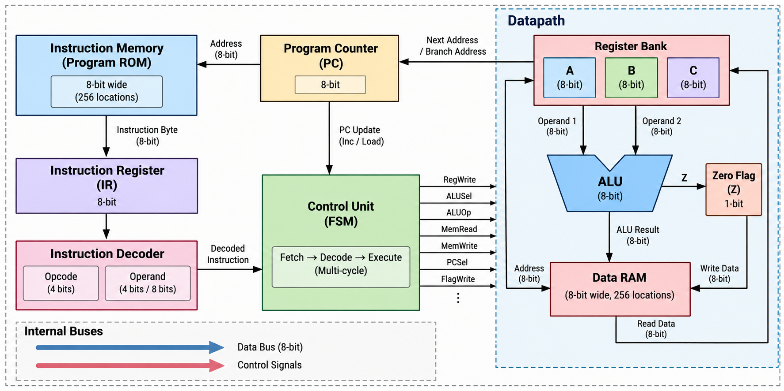

Mini CPU — Architecture

## Overview

A custom 8-bit, accumulator-based CPU with an FSM-based
multi-cycle control unit. The architecture consists of
a program counter, instruction memory, instruction
register, decoder, register bank, ALU, zero flag, and
data RAM.

Architecture Diagram

 Main Components

| Component | Function |
|---|---|
| Program Counter (PC) | Holds the address of the next instruction |
| Instruction Memory | Stores program instructions |
| Instruction Register (IR) | Holds the fetched instruction byte |
| Instruction Decoder | Identifies the opcode and operands |
| Control Unit (FSM) | Generates control signals and sequences execution |
| Register Bank | Contains 8-bit registers A, B, and C |
| ALU | Performs arithmetic and logical operations |
| Zero Flag (Z) | Indicates whether a flag-updating result is zero |
| Data RAM | Stores data accessed by load and store instructions |

 Key Specifications

- Data width: 8 bits
- Registers: A, B, C (8 bits each)
- Program Counter: 8 bits
- Flag: Zero flag (Z)
- Memory organization: Separate instruction memory and data RAM
- Execution: Multi-cycle, FSM-controlled

*Note: The instruction encoding, memory capacity, and detailed
datapath connections will be finalized during design.*
